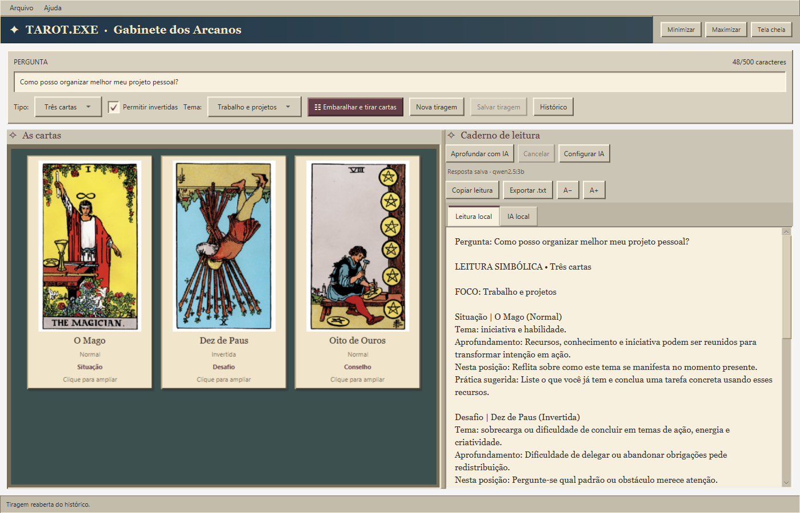
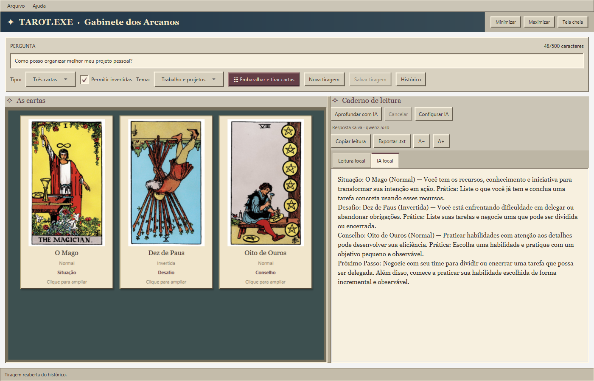
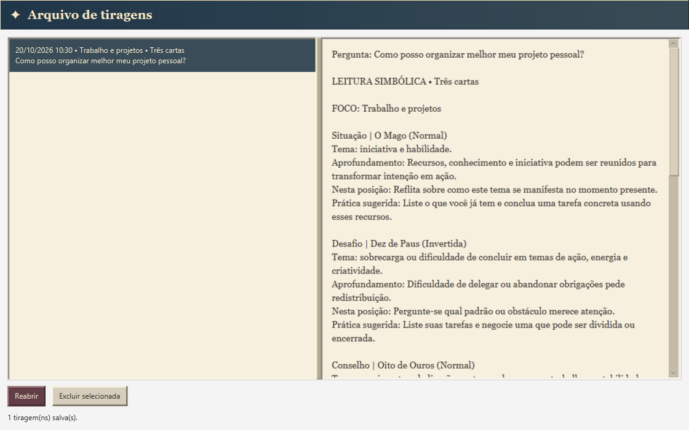
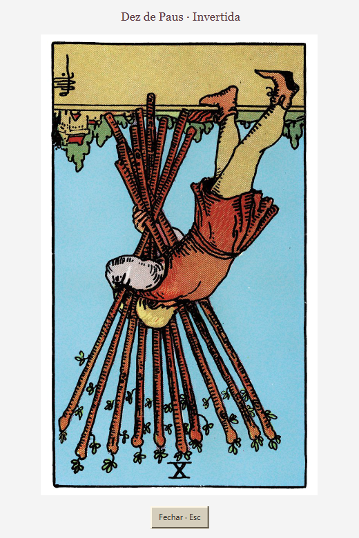
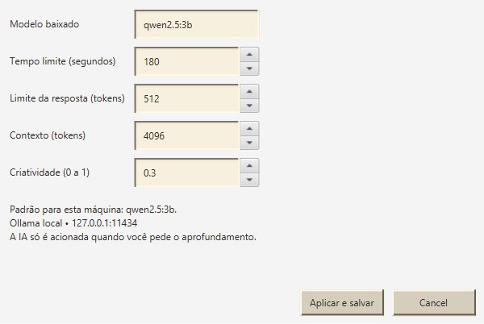
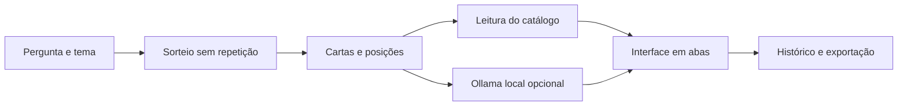

<div align="center">
  

# Tarot.exe · Gabinete dos Arcanos

**Um aplicativo desktop de tarot com visual Windows 95/98, leituras offline e IA local opcional.**

[](https://github.com/GustavoBenAbraham/tarot-exe/actions/workflows/ci.yml)


[](https://github.com/GustavoBenAbraham/tarot-exe/releases)

[Baixar para Windows](https://github.com/GustavoBenAbraham/tarot-exe/releases/download/v0.2.0/Tarot-Setup-0.2.0.exe) · [Versão portátil](https://github.com/GustavoBenAbraham/tarot-exe/releases/download/v0.2.0/Tarot-Portable-0.2.0.zip) · [Aprendizados](docs/APRENDIZADOS.md) · [Próximos passos](PENDENCIAS.md)

</div>



## Sobre o projeto

Sou **Gustavo, estudante de Java**, e este projeto faz parte do meu portfólio de aprendizado. A proposta foi sair de um MVP de sorteio de cartas e acompanhar a evolução até um programa que outra pessoa consiga instalar e usar.

O Tarot.exe reúne um baralho de **78 cartas ilustradas**, interpretações locais e uma interface inspirada no Windows clássico, com cores e tipografia vintage. O aprofundamento com **Ollama** é opcional: o aplicativo continua funcionando quando o modelo está desligado ou indisponível.

É um projeto de estudo em evolução, construído com apoio de ferramentas de IA na implementação, revisão e testes. Os aprendizados documentados representam os temas que estou praticando e aprofundando, sem pressupor domínio completo dessas tecnologias.

> As leituras são simbólicas e voltadas à reflexão. O aplicativo não promete prever acontecimentos, e os textos gerados por IA podem conter interpretações imprecisas.

## Download e instalação

| Versão | Download | Para quem |
| --- | --- | --- |
| Instalador Windows x64 | [Tarot-Setup-0.2.0.exe](https://github.com/GustavoBenAbraham/tarot-exe/releases/download/v0.2.0/Tarot-Setup-0.2.0.exe) | Instalar com atalho na área de trabalho, Menu Iniciar e desinstalador. |
| Portátil Windows x64 | [Tarot-Portable-0.2.0.zip](https://github.com/GustavoBenAbraham/tarot-exe/releases/download/v0.2.0/Tarot-Portable-0.2.0.zip) | Extrair a pasta inteira e abrir `Tarot.exe`. |
| Todas as versões | [GitHub Releases](https://github.com/GustavoBenAbraham/tarot-exe/releases) | Consultar notas, arquivos e checksums. |

**Requisitos:** Windows 10/11 de 64 bits. O **Java já está incluído**: para usar o programa instalado, não é necessário Maven, Eclipse ou terminal. As imagens e a interpretação do catálogo funcionam offline.

O instalador ainda não possui assinatura digital de editor. Ollama e modelos de IA não estão incluídos no download; são opcionais e instalados separadamente. Consulte o [guia de instalação](INSTALACAO.md).

## Funcionalidades

- **Uma ou três cartas:** sorteio sem repetição, posições definidas e opção de cartas invertidas.
- **78 ilustrações locais:** cartas em tamanho legível e ampliação por clique ou Enter.
- **Leitura por catálogo:** significados normais/invertidos, práticas sugeridas e síntese entre posições.
- **Quatro temas:** geral, relacionamentos, trabalho e projetos e autoconhecimento.
- **IA local opcional:** aprofundamento em segundo plano, cancelamento, timeout e parâmetros configuráveis.
- **Histórico:** salvar, consultar, reabrir e excluir tiragens, preservando os textos originais.
- **Compartilhamento:** copiar a leitura e exportar os textos local e de IA em UTF-8.
- **Conforto de leitura:** colunas ajustáveis, abas, A−/A+, tela cheia e preferências da janela.

## Capturas das funcionalidades

As imagens abaixo são capturas da interface real com uma pergunta de demonstração. A resposta de IA exibida veio de um teste real do modelo e foi reaberta pelo histórico; nenhum histórico pessoal foi usado.

### Aprofundamento com IA local

A leitura do catálogo permanece em uma aba própria. O texto da IA é identificado e pode ser salvo junto da tiragem.



<details>
<summary><strong>Ver histórico, carta ampliada e parâmetros da IA</strong></summary>

### Histórico de tiragens



### Carta ampliada

A janela mantém a orientação da carta e pode ser redimensionada.



### Parâmetros do Ollama

Modelo, tempo limite, tamanho da resposta, contexto e criatividade podem ser ajustados na interface.



</details>

## Como usar

1. Digite uma pergunta opcional e escolha o tema.
2. Selecione a tiragem de uma ou três cartas e clique em **Embaralhar e tirar cartas**.
3. Consulte **Leitura local** e clique nas cartas se quiser ampliá-las.
4. Se o Ollama estiver disponível, use **Aprofundar com IA**.
5. Use **Salvar tiragem**, **Copiar leitura** ou **Exportar .txt**.

A divisória vertical ajusta as colunas. **F11** alterna tela cheia; **Esc** retorna à janela. **A−/A+** ajustam o texto, e as preferências são lembradas ao fechar.

## IA local com Ollama

Instale o [Ollama](https://ollama.com/) e baixe um modelo. O usado nos testes desta versão foi:

```powershell
ollama pull qwen2.5:3b
```

Com o Ollama aberto, sorteie uma leitura e clique em **Aprofundar com IA**. Em **Configurar IA**, o padrão é:

| Parâmetro | Valor |
| --- | --- |
| Modelo | `qwen2.5:3b` |
| Tempo limite | 180 segundos |
| Limite da resposta | 512 tokens |
| Contexto | 4096 tokens |
| Temperatura | 0,3 |

O aplicativo envia pergunta, posições e significados ao Ollama em `127.0.0.1:11434`, utilizando o modelo local escolhido. Não há integração com API de IA paga. A interface permanece utilizável durante a geração; erros e cancelamentos preservam a leitura local.

Em um teste desta versão com 16 GB de RAM e inferência pela CPU, uma resposta foi concluída em **43 segundos**. Isso é uma medição de uma tiragem específica, não uma garantia de desempenho. [Detalhes dos testes de IA](TESTE-IA-LOCAL.md).

## O que estou aprendendo com este projeto

| Área | O que pratiquei |
| --- | --- |
| **Java e orientação a objetos** | Modelar cartas e leituras com records e enums; separar domínio, sorteio, interpretação e persistência. |
| **JavaFX** | Organizar layouts, eventos, propriedades, imagens e estados da interface. |
| **Programação assíncrona** | Integrar HTTP sem bloquear a janela e tratar cancelamento e respostas atrasadas. |
| **Persistência local** | Trabalhar com UTF-8, gravação por arquivo temporário, dados inválidos e compatibilidade do histórico. |
| **Testes** | Usar JUnit, simular uma API HTTP e exercitar regras, falhas e fluxos da interface. |
| **Entrega de software** | Gerar um runtime com jpackage, montar um instalador e testar atalhos, desinstalação e preservação dos dados. |
| **Documentação e GitHub** | Apresentar funcionalidades, registrar limites, automatizar verificações e publicar uma Release. |

Entre os aprendizados mais importantes: **uma janela que abre ainda não é um produto pronto**; operações lentas precisam respeitar o estado da interface; e testes de funcionamento não substituem a revisão humana da experiência e dos textos.

Continuo estudando organização de código, qualidade das respostas, acessibilidade, testes em outros ambientes e o processo de atualização do aplicativo. O relato completo está em [Aprendizados e evolução](docs/APRENDIZADOS.md).

## Tecnologias e organização

**Java 21 · JavaFX 21.0.6 · Maven Wrapper · JUnit 5 · HttpClient · Gson · Ollama · jpackage · Inno Setup**

A organização usa camadas simples por responsabilidade:

```text
src/main/java/com/tarotexe/
├── domain/             # Cartas, leituras, posições e temas
├── engine/             # Sorteio com SecureRandom
├── service/            # Catálogo, histórico, exportação, IA e preferências
├── TarotApp.java       # Tela principal e coordenação da interface
├── HistoryWindow.java  # Consulta de leituras salvas
└── CardWindow.java     # Ampliação das cartas

src/main/resources/     # Catálogos, imagens, ícone e estilos
src/test/java/          # Testes de regras, HTTP, arquivos e interface
packaging/              # Ícone, jpackage e instalador Windows
```



## Executar pelo código-fonte

Para desenvolver, configure um **JDK 21** em `JAVA_HOME`. Maven já vem pelo Wrapper; a primeira execução precisa de internet para baixar dependências.

```powershell
git clone https://github.com/GustavoBenAbraham/tarot-exe.git
cd tarot-exe
.\mvnw.cmd clean test
.\mvnw.cmd javafx:run
```

A suíte completa exige uma sessão gráfica, pois abre janelas JavaFX. Os testes não precisam do Ollama real. Para compilar e verificar o núcleo sem desktop:

```bash
./mvnw --batch-mode '-Dtest=AiSettingsTest,HistoryStoreTest,LocalInterpretationServiceTest,OllamaServiceTest,RandomEngineTest,ReleaseRefinementTest,TarotServiceTest' verify
```

O [GitHub Actions](https://github.com/GustavoBenAbraham/tarot-exe/actions) executa esses **40 testes de núcleo em Linux e Windows**. Os **13 testes de interface** são executados localmente em uma sessão gráfica. A validação da versão registra **53 testes passando**, além do teste real com Ollama e dos testes do instalador. [Relatório de validação](VALIDACAO-0.2.0.md).

Para construir instalador e ZIP, consulte [INSTALACAO.md](INSTALACAO.md). As capturas podem ser reproduzidas seguindo [CONTRIBUTING.md](CONTRIBUTING.md).

## Dados locais e privacidade

Histórico, configurações, preferências e logs ficam em `%USERPROFILE%\.tarot-exe`, fora da pasta de instalação. As perguntas e os textos são armazenados localmente, sem criptografia. Desinstalar o programa preserva essa pasta.

O repositório não inclui histórico pessoal, modelos de IA, ferramentas baixadas ou diretórios de build. Os instaladores são publicados em **Releases**, separados do código-fonte.

## Próximos passos

- Validar instalação e layout em outros computadores e escalas do Windows.
- Revisar e ampliar os contextos por carta e tema.
- Avaliar a IA com mais perguntas e modelos.
- Melhorar acessibilidade e organização da interface.
- Preparar assinatura digital e um processo de atualização.

O acompanhamento está em [PENDENCIAS.md](PENDENCIAS.md).

## Conteúdo, créditos e contribuições

As ilustrações Rider–Waite–Smith são de **Pamela Colman Smith**, com direção de **Arthur Edward Waite**. A origem e os metadados estão documentados em [ATTRIBUTION.md](src/main/resources/cards/ATTRIBUTION.md). Os textos em português e o ícone geométrico foram preparados para este projeto.

Os componentes de terceiros possuem seus próprios termos, reunidos em [THIRD-PARTY.md](packaging/THIRD-PARTY.md). Ainda não foi definida uma licença geral para o código do projeto.

Sugestões e relatos de problemas são bem-vindos. Consulte [CONTRIBUTING.md](CONTRIBUTING.md) e [CONTEUDO.md](CONTEUDO.md) para contribuir com código ou textos.

---

Desenvolvido como projeto de estudo por [Gustavo Ben](https://github.com/GustavoBenAbraham).
